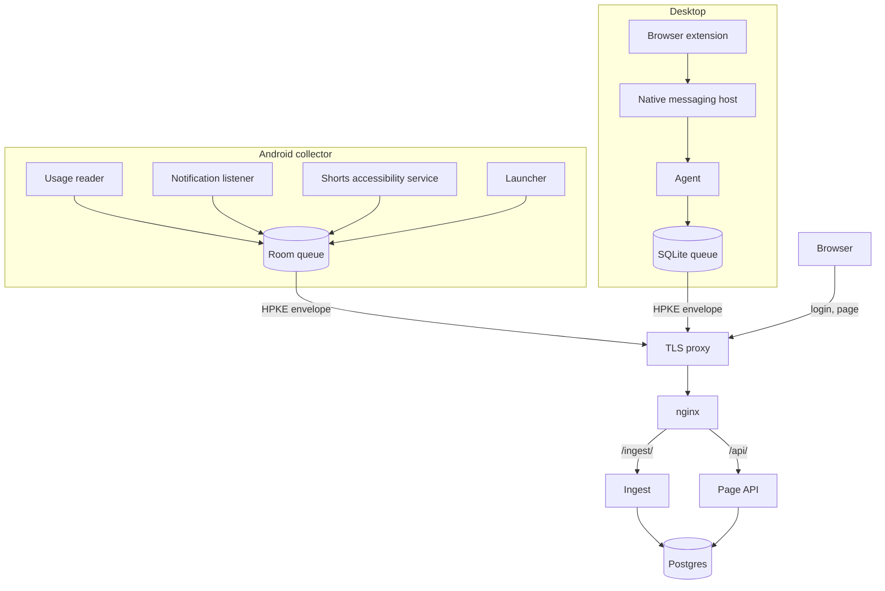

<div align="center">
  

# beConscient

**A self-hosted, privacy-first measure of all your screen time: phone and computer, work included.**

[](https://github.com/AndDev741/beConscient/actions/workflows/backend.yml)
[](https://github.com/AndDev741/beConscient/actions/workflows/frontend.yml)
[](https://github.com/AndDev741/beConscient/actions/workflows/android.yml)
[](https://github.com/AndDev741/beConscient/actions/workflows/desktop.yml)
[](https://github.com/AndDev741/beConscient/actions/workflows/extension.yml)
[](https://github.com/AndDev741/beConscient/actions/workflows/contract.yml)

</div>

beConscient records when you pick up a screen, what you do on it and what pulled you in. It covers your Android phone and your Linux desktop, and it shows the result on a page you host yourself. The headline is the number of hours you were awake away from screens.

The page and the desktop agent only measure and show, so you get an honest baseline before you change anything. When you are ready to change, the Android collector can become your home screen. It is text only. It puts a countdown in front of the apps you chose and can lock the phone to a short list of apps for a while.

> [!NOTE]
> beConscient is under active development.

## Features

- **Awake time away from screens.** The day total merges every device, so a minute on the phone and the computer at once counts once.
- **Phone and desktop.** An Android app for the phone and a Go agent for a GNOME Wayland desktop. A Manifest V3 extension adds YouTube and LinkedIn time from Chrome and Brave.
- **Sealed in transit.** Collectors wrap every batch in an HPKE envelope. A TLS proxy in front of your server sees only ciphertext.
- **Rebuildable.** Raw events are the source of truth and screen time is derived from them, so a new category or rule fixes past days.
- **Checked against Android.** The Validation view puts the measured total next to the one in Android Settings.
- **Pause and focus.** A launcher pause with a message you wrote, and focus periods that send every other app back to the home screen.
- **Hosted by you.** One Quarkus service and one Postgres database, with encrypted nightly backups.

## What it records

| Source | What | What it never sends |
|---|---|---|
| Android | Foreground app periods, unlocks, notification arrivals and whether you tapped or dismissed them, YouTube Shorts against regular YouTube, launcher pauses and focus periods | Notification content, senders, messages, your pause messages |
| Linux desktop (GNOME, Wayland) | Active screen time, split into work and personal by your work hours, or into any category for a stretch you mark on the page | Window titles, app names, URLs |
| Browser extension (Chrome, Brave) | Time on YouTube (with the video title) and on LinkedIn (page kind only) | Any other site, URLs, LinkedIn titles |

The server keeps only the fields listed in [`contract/events.md`](contract/events.md) and drops the rest.

## How it fits together



Each collector queues events locally and uploads them in batches. The backend stores the raw events, derives screen-time segments in the background and serves the page API. [`docs/design.md`](docs/design.md) holds the rules that turn events into screen time.

## The launcher

Set the Android collector as your home app and you get a text-only home screen: a clock, the block in force and a few pinned apps. Every other app is one swipe away.

- **Pause screen.** Mark apps as controlled and opening one from the launcher shows your message for the block in force, or "Is this important?" outside any block. A countdown runs before the app opens: 5 seconds for the first pause of an app on a day, doubling with each later one up to 60 seconds.
- **Focus period.** Start one from the home screen for 15 to 90 minutes, or let a locking block start one for as long as it lasts. Apps outside your allowed list go straight back to the home screen, and their notifications wait until the period ends.

Apps opened from a notification, the recents screen or a link skip the launcher and get no pause.

## Quick start

You need these tools to build and run the parts:

| Part | Needs |
|---|---|
| Backend | JDK 25 and Docker (Quarkus Dev Services starts Postgres 17) |
| Page and extension | Node 22 |
| Desktop agent and tools | Go 1.26 |
| Android collector | JDK 21 and the Android SDK, platform 36 |

Start the backend and the page in two terminals:

```sh
# terminal 1
cd backend
./mvnw quarkus:dev
```

```sh
# terminal 2
cd frontend
npm install
npm run dev
```

Open http://localhost:5173 and sign in as `owner` with the password `beconscient-dev`.

> [!TIP]
> To look around without a backend, run `npm run dev:mock`. The page answers from fixtures in the browser.

Then pair the desktop agent. Add a Linux computer on the **Devices** tab and build the agent:

```sh
cd desktop
go build -trimpath -o beconscient-agent ./cmd/beconscient-agent
./beconscient-agent pair --server http://localhost:8080 --key ../contract/keys/test-public.json --dev
./beconscient-agent run --dev
```

`pair` reads the one-time code from standard input. Compare the fingerprint it prints with the one on the Devices tab. To install the agent as a systemd user service, run `desktop/packaging/install.sh`.

The phone and the browser follow the same pattern. Their setup lives in [`android/README.md`](android/README.md) and [`extension/README.md`](extension/README.md).

> [!WARNING]
> The key pair in [`contract/keys`](contract/keys) is public on purpose, so anyone can read what it seals. The production backend and the release build of the collector refuse it. Generate your own with `go run ./cmd/keygen` from `tools/`.

## Repository layout

| Folder | What | Stack |
|---|---|---|
| [`contract/`](contract) | Event, envelope and API contracts, fixtures and envelope test vectors shared by every component | Markdown, JSON |
| [`backend/`](backend) | Ingest, derivation and the page API | Quarkus 3 on Java 25, Postgres 17, Flyway |
| [`frontend/`](frontend) | The web page | React 19, Vite, TypeScript |
| [`android/`](android) | The collector and launcher | Kotlin, Compose, Room, WorkManager |
| [`desktop/`](desktop) | The desktop agent and native messaging host | Go 1.26, SQLite |
| [`extension/`](extension) | YouTube and LinkedIn timing | Manifest V3, TypeScript |
| [`tools/`](tools) | Key generation and envelope vector checks | Go |
| [`deploy/`](deploy) | How production runs | Kubernetes, Flux |
| [`docs/`](docs) | Design notes | Markdown |

## Test

Every component has its own suite, and CI runs each one on pull requests.

| Component | Command |
|---|---|
| Backend (needs Docker) | `cd backend && ./mvnw -B test` |
| Frontend | `cd frontend && npm test` |
| Android | `cd android && ./gradlew testDebugUnitTest lintDebug assembleDebug` |
| Desktop | `cd desktop && go vet ./... && go test -race ./...` |
| Extension | `cd extension && npm test` |
| Envelope vectors | `cd tools && go run ./cmd/vectorcheck` |

Each implementation that seals envelopes writes its own vector file under [`contract/vectors`](contract/vectors), and every test suite opens all of them. That keeps every implementation in agreement.

## Deploy

Production needs Postgres 17, an HPKE key pair and the two images. CI builds a native backend image and the frontend image on every push to `main` and pushes them to GHCR. The Kubernetes manifests live in [be-infra](https://github.com/AndDev741/be-infra) and Flux rolls the new digests out.

[`deploy/README.md`](deploy/README.md) covers the secrets, the backups with restic and the restore drill. The backend reads all of its settings from the environment, listed in [`backend/README.md`](backend/README.md#configuration).

## Documentation

- [`docs/design.md`](docs/design.md): components, privacy rules and the derivation rules
- [`contract/`](contract): the envelope, the events, the page API and native messaging
- [`backend/README.md`](backend/README.md): configuration, keys, images
- [`frontend/README.md`](frontend/README.md): the views, mock mode and the security choices
- [`android/README.md`](android/README.md): build, signing, install and onboarding
- [`desktop/README.md`](desktop/README.md): commands, how time is measured, the queue
- [`extension/README.md`](extension/README.md): build, load and permissions
