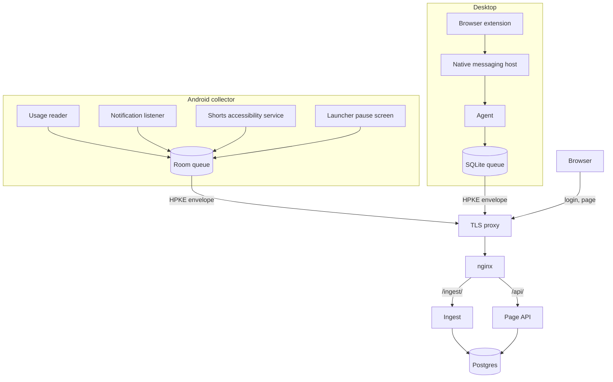
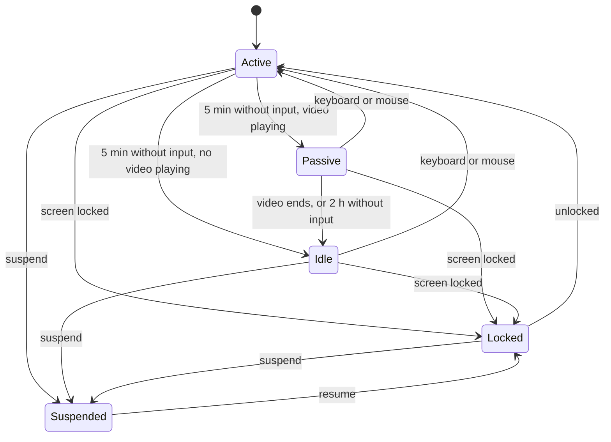

# Design

beConscient measures all of one person's screen time, on an Android phone and a Linux desktop, and shows it on a self-hosted web page. It started as an honest baseline before any attempt to reduce screen time. The page and the computer only measure and show. On the phone, the collector can also be the home screen: for apps the owner chose, it shows a short pause before opening them. It never blocks an app.

The wire formats live in [`contract/`](../contract). This document owns the rules that turn raw events into screen time.

## Components

| Folder | What |
|---|---|
| `backend/` | Quarkus service: ingest, derivation, page API. |
| `frontend/` | React page. |
| `android/` | Kotlin collector. |
| `desktop/` | Go agent and native messaging host. |
| `extension/` | Manifest V3 extension for Chrome and Brave. |
| `deploy/` | Production notes; the manifests live in be-infra. |
| `contract/` | Event, envelope and API contracts shared by all of the above. |

## Privacy rules

- Raw events exist in clear only on the owner's server. The transport proxy sees ciphertext. Off-server backups are encrypted on the server before they leave.
- The desktop never reports window titles, application names or URLs. It reports active-time intervals, plus YouTube and LinkedIn time from the extension. YouTube intervals carry the video title. LinkedIn intervals carry only a coarse page kind.
- Notifications are recorded as app, time and outcome (tapped, dismissed). Never title, text, sender or conversation.
- The server enforces the allowed fields in `contract/events.md` and drops anything else.

## Raw events and derivation

Raw events are the source of truth. Screen-time segments are a projection that can always be rebuilt.

- A **block** is one device on one UTC day. Deriving a block reads back far enough to recover the state open at its start and clips segments at its edges. Each block stores the state it ends in; if a rebuild changes that state, the next block is marked dirty.
- Dirty marks are rows with ids. A derivation pass claims ids, writes segments and deletes those ids in one transaction, holding a per-device database lock. An event committed during a pass is picked up by the next pass.
- The scheduled derivation never overlaps itself, and the backend deploys with the `Recreate` strategy so two pods never derive at once.
- Each segment carries the derivation version. A version bump triggers a resumable background rebuild, block by block. While it runs, the page shows "recalculating" with progress. A process with an older version refuses to write.
- Segments are stored in UTC. The local day is computed when reading.
- Suspect events (more than 1 day in the future, or more than 10 days before the server first heard from that sensor) are kept but excluded from derivation and never widen a dirty range.
- Excluded events (see corrections) are skipped by derivation.

### Phone rules

- An app interval runs from `ACTIVITY_RESUMED` to `ACTIVITY_PAUSED` or `ACTIVITY_STOPPED` of the same package.
- Intervals of the same package separated by at most 2 seconds merge.
- All time is clipped to stretches where the screen is on (`SCREEN_INTERACTIVE` to `SCREEN_NON_INTERACTIVE`) and unlocked (outside `KEYGUARD_SHOWN` to `KEYGUARD_HIDDEN`). Audio with the screen off therefore never counts; video watched without touching does.
- An open interval closes at screen off, or at `DEVICE_SHUTDOWN`.
- The launcher (the `home_package` from the latest health record before the instant) and System UI (`com.android.systemui`) are not apps. Screen-on, unlocked time with no attributable app goes to the built-in `Unattributed` bucket.
- When two apps are resumed at once (split screen), the most recently resumed one owns the time, so a device's segments never overlap.
- Invariants checked on every block: no overlapping segments within a device, and at most 24 hours (or the length of a daylight-saving day) per device per day. Violations are shown in the backstage view.
- An **unlock** is each entry into screen-on-and-unlocked, with or without `KEYGUARD_HIDDEN`. Its first app is the first `ACTIVITY_RESUMED` of a non-launcher package within 60 seconds; otherwise it has none.
- **Shorts**: the accessibility markers are intersected with YouTube segments. Time inside `enter`..`exit` becomes subject `app:com.google.android.youtube#shorts`. An open `enter` closes when YouTube leaves the foreground or the screen turns off. Without markers, time stays as YouTube.
- **Notifications**: counted at read time. Updates, group summaries and ongoing notifications are excluded from "posted". A removal with reason `click` counts as tapped; `cancel` and `cancel_all` count as dismissed.
- **Pauses**: stored as raw events only; they change no segment. When the collector is the home app, its own screens (home, app list, pause screen) are launcher time and go to `Unattributed`, like any launcher.

### Launcher

The collector can be set as the phone's home app. The home screen is text only: a clock, the block in force and a few pinned apps, with every app one swipe away.

- The owner marks apps as **controlled** and defines **blocks** on the phone: a name, days, a start and an end, a message and an optional alternative app. A block whose end is at or before its start runs past midnight and belongs to the day it started.
- Opening a controlled app from the launcher shows the **pause screen**: the message of the block in force, or "Is this important?" outside any block, and a 5-second countdown before the app can be opened. Going back and opening the alternative work from the first second.
- Each pause sends one `android.pause` event with the app, the block name, the outcome and the wait. The message stays on the phone.
- Apps opened from notifications, recents or links skip the launcher and get no pause.

### Desktop rules

The agent's state machine:

- Counted time is Active plus Passive. Entering Idle trims the open interval back to the last input, as a new revision.
- "Video playing" means the extension reports a playing video, or a GNOME session idle inhibitor is active while an MPRIS media player reports `Playing`. Keep-awake tools and jobs left running (an agent working overnight) hold an idle inhibitor with nothing playing, so that time goes to Idle after 5 minutes. A call with no media player and no input for 5 minutes stops counting too.
- **Classification**: active time inside the work window is `Work`; outside it, or on a non-working day, it is `Personal computer`.
- **Marked stretches**: the owner can mark a stretch on the page with a category ("20:00 to 21:45, Study"). Computer time inside it takes that category, whatever the work window says. The agent never learns what was on screen, so this is the only way computer time gets a category of its own. Like the windows, marks are applied when reading. Site time inside a mark keeps its subject.
- **Sites**: `browser.site` intervals are clipped to the agent's counted intervals, so the lock cut, idle and the 2-hour cap apply to them too. Clipped site time leaves `Work` or `Personal computer` and goes to the site's subject.
- A site counts while its tab is active in the focused browser window and the computer is active. A video playing in the active tab of an unfocused window counts only while the agent is Passive, so music playing behind an editor while typing stays as work.

## Reading

- **Categories** are applied when reading, so reclassifying a subject fixes the past.
- **Windows** (work and awake) are versioned by the local date they became valid. Edits apply from that date forward.
- **Union**: the day total and the headline use the union of all devices' segments. In category and hourly views, overlapping time belongs to the phone.
- **Headline**: awake window minus screen time inside it. For today, only the awake hours already elapsed count. Screen time outside the awake window is reported on its own line. An awake window that crosses midnight belongs to the day it started.
- **Incomplete day**: a health gap (see `contract/events.md`) inside the awake window marks the day incomplete and names the silent sensor.
- **Closed day**: a past day is closed when every active installation has caught up: its acknowledged watermark passed the end of that local day, or its last health record before that end reported an expected stop with an empty queue. Revoked installations never hold a day open. Validation only needs the phone to have caught up.
- **Day zone**: each instant takes the phone's zone in effect at that time (from `android.tz_change` markers and batch headers), with `Europe/Lisbon` as fallback.
- **Coverage**: the server records, per sensor, when it first heard from it and the earliest event time it holds. Partial days are those before the earliest event time. Trends and validation skip days before it. On first pairing the phone back-fills about 7 days of usage history; notifications and Shorts start from zero.

## Health

- The phone sends a health record every 15 minutes, the agent every 5 minutes. The extension sends a heartbeat to the agent every 5 minutes, which the agent reports as the `extension_chrome` or `extension_brave` sensor.
- Last contact and gaps use the device timestamp and the record id, never the receive time, so a replayed envelope cannot hide a dead sensor.

## Backups

The database lives in a Postgres instance shared with another application on the same cluster, with its own database and role. A Kubernetes CronJob dumps each database with `pg_dump -Fc` and stores the dumps with restic in an object-storage bucket. restic encrypts on the server. A weekly CronJob restores the latest snapshot into a scratch database and compares row counts. Collectors keep acknowledged events for 14 days and can resend them after a restore.
